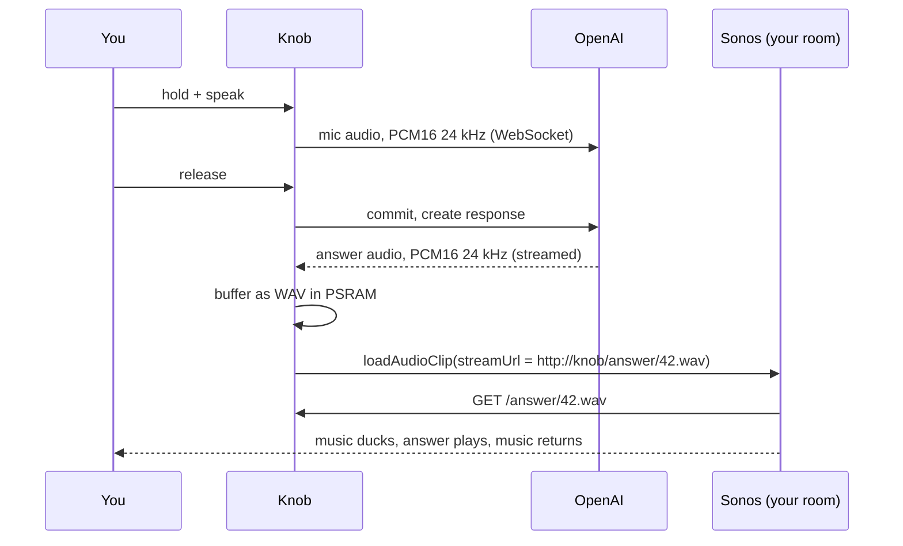

# Voice assistant: plan

Ask the knob a simple question ("how long do I boil an egg?", "what's the
weather tomorrow?") and hear the answer from the Sonos speaker in the room,
over whatever is playing. The music ducks, the answer plays, and the music
comes back on its own.

This replaces [`voice-mode-plan.md`](voice-mode-plan.md), which played answers
on the knob's own DAC. The radio app's old voice mode was removed in `30f8248`;
the shared `components/knob_voice` component (mic capture, WebSocket session,
tool dispatch) is still in the tree.

## How it should feel

| Gesture | Today | With the assistant |
| --- | --- | --- |
| Turn | Volume (browse: stations) | Same |
| Tap | Browse stations | Same |
| Tap the artwork | Play/pause (Spotify, AirPlay...) | Play/pause for everything, stop for radio |
| Press and hold | Stop playback | **Talk.** Release to send |
| Swipe up | Speakers | Same |

Hold-to-talk instead of a wake word or double-tap:

- The mic only listens while your finger is down. No always-on mic, no false
  triggers from the TV.
- No echo cancellation needed: the mic is off before the Sonos starts talking,
  so the answer never feeds back into the question.
- Stop moves to the artwork tap, which already means play/pause for other
  sources. One gesture for "make it stop" everywhere.

On screen, the home view stays put and reuses what's there (no new screen, no
full-screen animation):

| State | Artwork tile | Title | Subtitle |
| --- | --- | --- | --- |
| Listening | Dims, a level ring pulses with your voice | Live transcript | Listening |
| Thinking | Ring spins slowly | Your question | Thinking |
| Answering | Ring breathes with the reply | Your question | Answering in Living Room |
| Error | Brief red ring, then back | Unchanged | What went wrong, in words |

## How the answer gets to the Sonos

Sonos can't receive audio pushed at it. It plays URLs. So the knob briefly
becomes a tiny web server for the answer:

**Playing the clip:** Sonos' local WebSocket API on port 1443
(`wss://<speaker>:1443/websocket/api`, namespace `audioClip:1`, command
`loadAudioClip` with `streamUrl`, `priority: HIGH`). This is what Home
Assistant's "announce" uses: Sonos ducks whatever is playing, plays the clip,
and restores the volume by itself, even for Spotify or the TV. Clips must be
MP3 or WAV. It's S2-only and needs the `X-Sonos-Api-Key` header and the
`v1.api.smartspeaker.audio` subprotocol (see `jjlawren/sonos-websocket`).
The player id comes from `groups:1 getGroups` on the same socket.

**Fallback (S1, or no `AUDIO_CLIP` capability):** snapshot the coordinator's
URI, position and volume, `SetAVTransportURI` the WAV, play, then restore.
Clunkier (Spotify Connect sessions don't survive it), so only as a fallback.

**Which speaker:** the room the knob controls, not the whole group. The person
asking is in that room; the other rooms keep their music at full volume.

**Buffer, then play:** wait for the full answer before calling
`loadAudioClip`. Short answers render faster than real time, so the wait is
roughly the model's time-to-finish (about 1-2 s for a sentence or two). A
streamed WAV of unknown length risks Sonos stalling or cutting off. Ten seconds
of 24 kHz mono PCM16 is 480 KB, which fits PSRAM easily (cap at 30 s / 1.4 MB).

## OpenAI side

Two current options; pick when implementing (the API has moved fast, so
re-check the docs first):

- **GPT-Live** (`wss://api.openai.com/v1/live/sessions`, `gpt-live-1`): built
  for spoken Q&A, and can delegate to a Responses model with `web_search`, so
  "what's the weather tomorrow" works without us writing tools.
- **Realtime API** (`wss://api.openai.com/v1/realtime?model=gpt-realtime-2.1`):
  better if we want the assistant to *act* (change station, set a timer,
  group rooms) through function calls. The old radio tools from `30f8248^`
  (`apps/radio/main/voice/tools_radio.cpp`) are a starting point.

Either way: PCM16 mono 24 kHz in and out, manual turn-taking (commit on
release, no server VAD), no `OpenAI-Beta` header (GA interface), and short
instructions ("answer in one or two spoken sentences").

The API key is already stored in NVS (`settings_get_openai_api_key`), set via
`sdkconfig.defaults.local`. Fine for a personal device; a shared device should
fetch short-lived ephemeral keys from a small server instead.

## Where the code lives

| Piece | Location | New or existing |
| --- | --- | --- |
| Mic capture, OpenAI session, tool dispatch | `components/knob_voice/` | Existing. Update the protocol to the GA/Live event names, drop the DAC playback path, add an "answer finished" callback with the PCM buffer |
| Answer server (`GET /answer/<id>.wav`) | `components/knob_sonos/src/clip_server.cpp` | New. `esp_http_server`, serves one PSRAM buffer with a WAV header and `Content-Length` |
| `loadAudioClip` over the local WebSocket | `components/knob_sonos/src/audio_clip.cpp` | New. Runs on the Sonos net task like every other speaker command, so it can't race a volume change |
| Public call | `sonos_announce(pcm, samples, rate)` in `sonos.h` | New. Serves the buffer and plays it on the controlled room. Reusable: the timer can announce "pasta's done" the same way |
| Glue: hold → listen → answer → announce | `apps/radio/main/assistant/assistant.cpp` | New. Owns the state machine and posts `APP_EVENT_ASSISTANT_STATE` |
| Assistant tools (optional) | `apps/radio/main/assistant/tools_radio.cpp` | Restore from history if we go the Realtime route |
| UI states | `apps/radio/main/ui/ui.cpp` + a small `ui/assistant_ring.cpp` | New ring object over the artwork tile; title/subtitle reuse |
| Decisions (state machine, WAV header, clip JSON) | `now_playing.cpp`-style pure files with host tests | Follows the pattern in `knob_sonos/test` and `apps/radio/test` |

## Performance budget

The UI must not get slower while a TLS WebSocket, the mic and an HTTP server
run. Measured with the simulator (`apps/radio/sim/run.sh`):

- Listening/answering ring: redraws only the artwork tile (≤ 140×140 px, about
  15% of the panel), at most 30 fps, driven by a smoothed mic level that only
  invalidates when the drawn value changes.
- No style changes on the edge arc during voice. It spans the whole panel, so
  any change on it repaints everything.
- Voice tasks (mic, WebSocket, HTTP server) run on core 0; LVGL stays alone on
  core 1. Audio buffers in PSRAM; nothing new in internal RAM beyond task
  stacks.
- Add an `assistant` scenario to the simulator and keep its numbers in the
  same range as "browse" (≤ 25% of the panel per frame).

## Phases

1. **Gesture move.** Artwork tap becomes stop for radio; long-press becomes a
   no-op. Ships on its own and frees the gesture. *Done when* stopping radio
   works from the artwork and the sim shows no regression.
2. **Announce.** `sonos_announce` + clip server + `loadAudioClip`, tested by
   announcing a bundled chime when a timer finishes. *Done when* the chime
   ducks Spotify and the TV on an S2 speaker, and the fallback works on S1.
3. **Ask.** Hold-to-talk, session, buffer, announce. *Done when* a spoken
   question gets a spoken answer in the controlled room in under ~3 s after
   release, and music resumes.
4. **Act (optional).** Station/volume/timer/grouping tools.

## Open questions to check early

- Does Sonos accept 24 kHz WAV for clips, or only 44.1/48 kHz? If not,
  upsample 2× to 48 kHz on the knob (cheap, linear is fine for speech).
- Does `loadAudioClip` work on stereo pairs and home theater setups when sent
  to the visible (left/soundbar) player?
- `esp_websocket_client` against the speaker's self-signed certificate: skip
  verification for the local socket only.
- What happens to an announcement if the room is in a group with other rooms
  playing? Expected: only the addressed player ducks.
